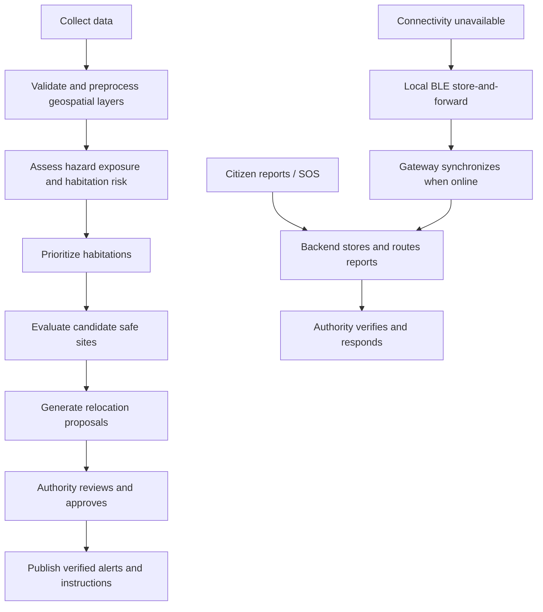
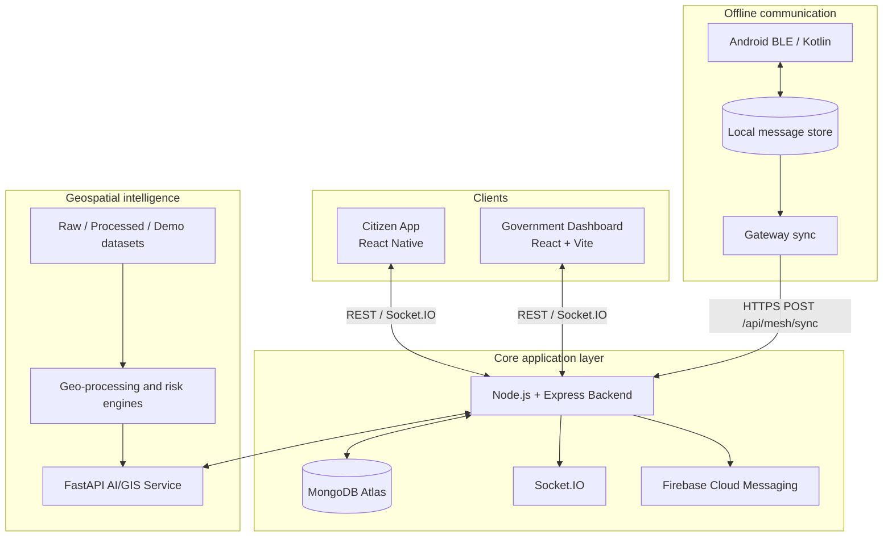

# RESQ-ZONE
### AI-Powered Multi-Hazard Risk Assessment, Safe Relocation & Offline Emergency Communication Network

> **From Hazard Maps to Safe Relocation Decisions.**  
> **When the network fails, the community becomes the network.**

RESQ-ZONE is a disaster-management decision-support platform designed to help authorities and communities move from identifying hazard-prone areas to planning and coordinating safer emergency responses.

The platform combines geospatial data processing, explainable risk assessment, habitation prioritization, safe-site capacity evaluation, proposed relocation planning, citizen reporting, government coordination and localized offline communication.

It is designed as a modular hackathon MVP, initially demonstrated through a flood/heavy-rainfall scenario in one selected region. The architecture is intended to support additional hazards and larger geographic areas in future iterations.

---

## Contents

- [1. Problem overview](#1-problem-overview)
- [2. Our solution](#2-our-solution)
- [3. Core objectives](#3-core-objectives)
- [4. End-to-end workflow](#4-end-to-end-workflow)
- [5. Main modules](#5-main-modules)
- [6. User roles](#6-user-roles)
- [7. System architecture](#7-system-architecture)
- [8. Technology stack](#8-technology-stack)
- [9. Repository structure](#9-repository-structure)
- [10. Data and AI/GIS approach](#10-data-and-aigis-approach)
- [11. Offline communication](#11-offline-communication)
- [12. Government and citizen communication](#12-government-and-citizen-communication)
- [13. Security, privacy and governance](#13-security-privacy-and-governance)
- [14. MVP scope](#14-mvp-scope)
- [15. Local development](#15-local-development)
- [16. Environment configuration](#16-environment-configuration)
- [17. API overview](#17-api-overview)
- [18. Testing strategy](#18-testing-strategy)
- [19. Demo workflow](#19-demo-workflow)
- [20. Limitations and responsible-use notes](#20-limitations-and-responsible-use-notes)
- [21. Future roadmap](#21-future-roadmap)
- [22. Documentation index](#22-documentation-index)

---

## 1. Problem overview

During floods, landslides, heavy rainfall and other emergencies, identifying a hazard is only one part of disaster response. Authorities may also need to determine:

1. Which habitations are exposed and should be assessed first?
2. How many people may need assistance?
3. Which vulnerable habitations face difficult evacuation conditions?
4. Which potential relocation sites are safe and have sufficient capacity?
5. How can people and authorities exchange critical information when internet or cellular networks are unavailable?

Hazard maps and warning systems provide important information, but operational decisions also require population exposure, vulnerability, infrastructure, accessibility, shelter capacity and communication status to be considered together.

RESQ-ZONE is designed to connect these pieces into one decision-support workflow.

## 2. Our solution

RESQ-ZONE combines a geospatial risk-analysis service, a central backend, a citizen mobile application, a government web dashboard and an Android BLE offline communication module.

The platform aims to:

- Consolidate relevant hazard, weather, terrain, population and infrastructure information.
- Generate explainable, relative-risk assessments for habitations.
- Prioritize habitations for review based on risk and vulnerability factors.
- Evaluate candidate safe sites using safety, capacity, services and accessibility.
- Generate feasible relocation proposals for review by authorized authorities.
- Allow citizens to submit hazard reports and SOS messages.
- Allow authorities to verify reports and publish official alerts.
- Provide localized, short-range BLE store-and-forward communication when conventional connectivity is unavailable.
- Synchronize queued messages with the central backend when an internet-connected gateway becomes available.

RESQ-ZONE complements existing official warning and disaster-management systems. It is not intended to replace them.

## 3. Core objectives

| Objective | What the platform provides |
|---|---|
| Risk visibility | Map-based hazard and habitation risk information |
| Prioritization | Explainable ranking of habitations requiring attention |
| Safer relocation | Safe-site screening and capacity-aware proposals |
| Citizen participation | Hazard reporting, SOS and alert acknowledgement |
| Authority coordination | Incident review, alert publication and relocation approval |
| Resilience | Cached information and localized BLE message relaying |
| Traceability | Source metadata, timestamps, status tracking and audit logs |

## 4. End-to-end workflow



The operational cycle is:

**Detect → Assess → Prioritize → Relocate → Communicate**

## 5. Main modules

### 5.1 Citizen mobile application

The citizen application provides:

- Registration and login.
- Location-aware home screen.
- Nearby risk information and map.
- Hazard report submission with location and optional photo.
- SOS submission with location, people count and assistance requirement.
- Risk details and contributing factors.
- Nearby safe-site information.
- Official alerts and acknowledgement.
- Offline communication status, queued messages and synchronization state.

### 5.2 Government dashboard

The government dashboard provides:

- Role-protected authority login.
- Command overview and operational counts.
- Map layers for hazard zones, habitations, reports, SOS messages and safe sites.
- Citizen report review and verification.
- Habitation risk and priority lists.
- Safe-site capacity and service management.
- Relocation proposal review and approval/rejection.
- Official alert drafting, preview and publication.
- Status updates through backend APIs and Socket.IO events.

### 5.3 Backend and coordination layer

The backend is the central application coordinator and source of truth. It provides:

- Authentication and role-based authorization.
- REST APIs for all client applications.
- MongoDB persistence.
- Citizen reports, incidents and SOS management.
- Hazard, habitation and safe-site data APIs.
- Integration with the AI/GIS service.
- Relocation proposal lifecycle.
- Alert publishing and acknowledgement.
- Socket.IO real-time updates.
- BLE gateway synchronization.
- Audit logging and validation.

### 5.4 AI and GIS service

The AI/GIS service provides:

- Data ingestion and preprocessing.
- Coordinate reference system validation and transformation.
- Spatial joins and exposure calculations.
- Habitation feature engineering.
- Explainable risk scoring.
- Habitation prioritization.
- Safe-site suitability and capacity assessment.
- Capacity-constrained relocation recommendations.
- FastAPI endpoints for backend integration.

The MVP begins with a transparent weighted risk baseline. More advanced ML models may be introduced only when suitable labelled data is available.

### 5.5 BLE offline communication

The Android BLE module provides:

- BLE capability and permission checks.
- Nearby RESQ-ZONE device discovery.
- GATT-based message transfer.
- Local persistent message storage.
- Duplicate detection.
- Expiry and hop-limit enforcement.
- Store-and-forward relay.
- Gateway synchronization with the backend.

BLE is a localized best-effort fallback. It is not a replacement for cellular, internet, radio or official emergency communication infrastructure.

## 6. User roles

| Role | Main permissions |
|---|---|
| `CITIZEN` | Submit reports/SOS, view permitted risk and safe-site information, receive and acknowledge alerts |
| `FIELD_OFFICER` | Review assigned/local reports and update permitted incident statuses |
| `DISASTER_AUTHORITY` | Verify operational information, manage relocation decisions and publish authorized alerts |
| `ADMIN` | Manage system-level access and administrative operations |

Public registration must create only `CITIZEN` accounts. Authority roles must be provisioned through a controlled process.

## 7. System architecture

The system uses a modular architecture:



Detailed diagrams are in [`architecture/architecture.md`](architecture/architecture.md).

## 8. Technology stack

| Layer | Technology | Responsibility |
|---|---|---|
| Citizen app | React Native, TypeScript | Android citizen experience |
| Navigation | React Navigation | Mobile screen navigation |
| Mobile maps | React Native Maps | Citizen map view |
| Local storage | SQLite / AsyncStorage | Cached state and offline queue metadata |
| Government UI | React, Vite, TypeScript | Authority dashboard |
| Styling | Tailwind CSS | Dashboard UI |
| Web maps | Leaflet / React-Leaflet | Geospatial visualization |
| HTTP client | Axios | API communication |
| Real-time client | Socket.IO Client | Live dashboard updates |
| Backend runtime | Node.js | Application runtime |
| Backend framework | Express | REST API |
| Backend language | TypeScript | Typed backend implementation |
| Database | MongoDB Atlas | Operational persistence |
| ODM | Mongoose | Schemas, models and indexes |
| Authentication | JWT, bcrypt | Authentication and password hashing |
| Validation | Zod or Joi | Request validation |
| Real-time server | Socket.IO | Event delivery |
| Push notifications | Firebase Admin / FCM | Online push notification integration |
| AI/GIS service | Python, FastAPI, Pydantic | Risk and relocation APIs |
| Data processing | Pandas, NumPy | Tabular processing and feature engineering |
| Geospatial processing | GeoPandas, Shapely | Vector geospatial operations |
| Raster processing | Rasterio / GDAL | DEM and raster workflows where needed |
| ML extension | scikit-learn | Future/optional trained models |
| Android BLE | Kotlin, Android BLE APIs, GATT | Nearby device communication |
| Local BLE storage | SQLite | Persistent store-and-forward queue |
| Version control | Git, GitHub | Collaboration and source control |
| API testing | Postman / curl / automated tests | API verification |
| Map inspection | QGIS | Geospatial data inspection |

See [`technical/tech-stack.md`](technical/tech-stack.md) for details and technology boundaries.

## 9. Repository structure

The intended repository layout is:

```text
RESQ-ZONE/
├── README.md
├── idea/
│   ├── README.md
│   ├── citizen-app/
│   ├── government-dashboard/
│   ├── backend/
│   ├── ai-gis/
│   ├── offline-communication/
│   └── shared/
│       ├── README.md
│       ├── api-contract.md
│       └── data-models.md
├── architecture/
│   ├── architecture.md
│   ├── data-flow.md
│   ├── deployment-architecture.md
│   └── diagrams/
├── technical/
│   ├── tech-stack.md
│   ├── folder-structure.md
│   ├── ai-gis-design.md
│   ├── ble-offline-protocol.md
│   └── integrations.md
├── contracts/
│   ├── api-contract.md
│   ├── data-models.md
│   └── status-enums.md
└── guides/
    ├── local-setup.md
    ├── git-workflow.md
    ├── testing.md
    └── demo-runbook.md
```

This is the documentation target structure. Keep it aligned with the actual source folders as they are created; do not create empty placeholder source modules merely to match a diagram.

## 10. Data and AI/GIS approach

### Data categories

The MVP may use the following categories, subject to actual availability and licensing:

- Rainfall and weather warnings.
- Satellite-derived hazard information.
- Digital elevation and terrain.
- Flood susceptibility/extent layers.
- Rivers, water bodies and drainage.
- Roads and accessibility.
- Population and habitation information.
- Hospitals, shelters and essential services.
- Citizen-submitted reports.

Potential public data providers include IMD, ISRO/Bhuvan/NDEM and other official or open geospatial sources. Availability, access method, licence, timestamp and coverage must be verified for each dataset. Do not assume every source offers a public API.

### MVP risk scoring

The initial transparent baseline is:

```text
riskScore = 100 × (
  0.30 × hazardExposure +
  0.20 × rainfallTrigger +
  0.15 × populationExposure +
  0.15 × vulnerability +
  0.10 × evacuationDifficulty +
  0.10 × infrastructureGap
)
```

All input features are normalized to 0–1 where applicable.

Prototype bands:

| Score | Category |
|---:|---|
| 0–19 | SAFE |
| 20–39 | LOW |
| 40–59 | MODERATE |
| 60–79 | HIGH |
| 80–100 | CRITICAL |

These are illustrative MVP thresholds, not official government standards or validated scientific thresholds. The UI and API must identify the model/rule version and data freshness.

### Safe-site evaluation

A candidate site is assessed using:
- Hazard safety.
- Total capacity and current occupancy.
- Remaining capacity.
- Water and sanitation.
- Healthcare and other services.
- Road access and logistics.

A site must not be recommended only because it is nearby. Hard safety exclusions should be applied before ranking.

### Relocation proposals

The engine ranks feasible assignments while respecting site capacity and safety constraints. All outputs remain `PROPOSED` until an authorized authority approves them.

## 11. Offline communication

The offline module uses Android BLE to exchange emergency packets between nearby participating devices.

Core principles:
- Store a message locally before attempting transmission.
- Use a unique message ID for deduplication.
- Include creation and expiry timestamps.
- Include a hop counter and maximum hop count.
- Persist received messages before acknowledging.
- Relay only eligible, non-expired messages.
- Synchronize through an internet-connected gateway.
- Retain messages when synchronization fails.

The MVP does not promise:
- Unlimited range.
- Guaranteed delivery.
- Always-on background relay.
- Compatibility with every Android device.
- Full Bluetooth Mesh standard support.

See [`technical/ble-offline-protocol.md`](technical/ble-offline-protocol.md).

## 12. Government and citizen communication

Online path:
1. Authority creates an alert.
2. Backend validates authorization and content.
3. Alert is published and audit-logged.
4. Backend emits a Socket.IO event and attempts push notification.
5. Citizen app displays the alert.
6. Citizen acknowledgement is recorded separately.

Offline path:
1. A citizen creates an SOS.
2. The device stores the message locally.
3. Nearby devices may relay it using BLE.
4. An internet-connected gateway uploads it.
5. Backend validates and deduplicates it.
6. The government dashboard receives the SOS as unverified information.

A published alert, an FCM provider response, device receipt and citizen acknowledgement are different states and must not be conflated.

## 13. Security, privacy and governance

- Hash passwords using bcrypt.
- Use JWT-protected APIs and role-based access control.
- Provision authority accounts through a controlled process.
- Validate every request and uploaded file.
- Apply rate limits to authentication, report and SOS endpoints.
- Use HTTPS for deployed API and gateway traffic.
- Keep secrets in environment variables.
- Restrict Socket.IO events by role and authorization.
- Avoid broadcasting unnecessary personal information.
- Avoid placing personal emergency details in BLE advertisements.
- Maintain audit logs for verification, alert publication and relocation approval.
- Define retention and access policies before handling real emergency data.
- Treat citizen-submitted and BLE-relayed reports as unverified until reviewed.

## 14. MVP scope

### In scope
- One selected region.
- Flood/heavy-rainfall scenario.
- Citizen login, hazard report and SOS.
- Government login and report verification.
- Map-based hazard/habitation/safe-site view.
- Transparent risk scoring and habitation priority.
- Safe-site suitability and capacity.
- Relocation proposal generation and authority approval.
- Alert publishing and acknowledgement.
- Android two-device BLE transfer, local persistence and gateway sync.

### Out of scope for the first MVP
- National-scale live data ingestion.
- Exact disaster prediction.
- Autonomous evacuation decisions.
- Guaranteed BLE delivery or long-range mesh.
- Full Bluetooth Mesh standard.
- Advanced vehicle routing and fleet dispatch.
- Continuous tracking of all citizens.
- Production certification for emergency-service use.

## 15. Local development

Each module has its own setup instructions. Refer to [`guides/local-setup.md`](guides/local-setup.md).

Typical development order:

1. Clone repository and agree shared contracts.
2. Start MongoDB connection and backend health endpoint.
3. Start FastAPI health endpoint.
4. Seed common demo data.
5. Start government dashboard and citizen app.
6. Connect report submission to backend.
7. Connect AI risk output to backend and dashboard.
8. Test BLE transfer on two physical Android phones.
9. Integrate gateway synchronization.

Do not commit `.env` files or credentials.

## 16. Environment configuration

Each module should provide its own `.env.example`. Typical backend variables may include:

```env
NODE_ENV=development
PORT=5000
MONGODB_URI=
JWT_SECRET=
JWT_EXPIRES_IN=1d
CLIENT_ORIGINS=
AI_SERVICE_URL=http://localhost:8000
FIREBASE_PROJECT_ID=
FIREBASE_CLIENT_EMAIL=
FIREBASE_PRIVATE_KEY=
```

Dashboard and mobile configuration may include an API base URL and map configuration. AI/GIS may include dataset paths and service port. BLE should not contain server secrets; gateway authentication must follow the backend team's agreed mechanism.

These are example variable names, not a guarantee that every variable is already implemented. Keep actual `.env.example` files synchronized with the code.

## 17. API overview

The backend exposes routes grouped around:

- `/api/auth`
- `/api/reports`
- `/api/sos`
- `/api/hazards`
- `/api/habitations`
- `/api/safe-sites`
- `/api/relocation`
- `/api/alerts`
- `/api/mesh`

The AI/GIS service exposes:
- `GET /health`
- `POST /predict-risk`
- `POST /analyze-region`
- `POST /safe-sites/evaluate`
- `POST /relocation/recommend`

The exact request and response schemas are maintained in [`contracts/api-contract.md`](contracts/api-contract.md). Treat implemented API definitions as authoritative; update the documentation when code changes.

## 18. Testing strategy

- Unit tests for risk calculations, capacity checks, prioritization and validation.
- Backend integration tests for authentication, RBAC, reports, SOS, alerts and mesh deduplication.
- Frontend tests for critical form states and API error handling.
- Geospatial checks for CRS, geometry validity and coordinate order.
- Physical Android BLE tests for discovery, transfer, persistence, deduplication and sync.
- End-to-end tests for citizen report → authority verification.
- End-to-end demo for SOS → BLE relay → gateway sync → dashboard.

See [`guides/testing.md`](guides/testing.md).

## 19. Demo workflow

Use one consistent flood/heavy-rainfall scenario and the same habitation IDs, safe-site IDs and coordinates across every module.

1. Citizen opens the app and views the demo risk map.
2. Citizen submits a flood report.
3. Backend stores the report.
4. Government officer reviews and verifies it.
5. AI/GIS analysis provides habitation risk and priority.
6. Dashboard displays prioritized habitations.
7. Safe-site engine evaluates available shelters and capacity.
8. System generates a proposed relocation assignment.
9. Authorized authority approves or rejects the proposal.
10. Authority publishes an alert.
11. Citizen receives the alert online.
12. Internet is disabled for the offline demonstration.
13. Citizen A creates an SOS.
14. Nearby Android device receives and stores the SOS over BLE.
15. A gateway regains connectivity and synchronizes the message.
16. Dashboard displays the SOS as an unverified emergency report.

The success criterion is one connected, honest workflow—not a large number of disconnected features.

## 20. Limitations and responsible-use notes

RESQ-ZONE is a prototype decision-support platform. It must not be represented as an official warning authority, certified evacuation system or replacement for emergency services.

Risk outputs depend on input data quality, coverage, freshness and assumptions. Missing data can materially affect scores. Authorities must validate information and retain decision-making control.

BLE performance depends on device hardware, Android permissions, operating-system behavior, user proximity and app state. Message transfer is best-effort and may fail.

Never use simulated demo values as evidence of real-world risk or claim that a real authority has approved a plan unless that approval actually occurred.

## 21. Future roadmap

Potential future extensions, subject to validation and stakeholder requirements:

- Additional hazards such as landslides, cyclones, earthquakes and wildfires.
- More official data integrations and automated freshness checks.
- Better labelled datasets and validated predictive models.
- Multilingual and accessibility improvements.
- Stronger offline map caching and synchronization.
- More robust peer discovery and relay strategies.
- Improved route accessibility and resource planning.
- Integration with authorized government systems.
- Operational pilots with disaster-management stakeholders.
- Security, privacy and reliability audits.

## 22. Documentation index

| Document | Purpose |
|---|---|
| [`architecture/architecture.md`](architecture/architecture.md) | Complete logical and component architecture |
| [`architecture/data-flow.md`](architecture/data-flow.md) | Data movement and sequence flows |
| [`architecture/deployment-architecture.md`](architecture/deployment-architecture.md) | Development and deployment topology |
| [`technical/tech-stack.md`](technical/tech-stack.md) | Technologies, roles and rationale |
| [`technical/folder-structure.md`](technical/folder-structure.md) | Repository and module folder layout |
| [`technical/ai-gis-design.md`](technical/ai-gis-design.md) | GIS pipeline, features and risk logic |
| [`technical/ble-offline-protocol.md`](technical/ble-offline-protocol.md) | BLE protocol and store-and-forward behavior |
| [`technical/integrations.md`](technical/integrations.md) | Integration boundaries and external services |
| [`contracts/api-contract.md`](contracts/api-contract.md) | API groups and payload conventions |
| [`contracts/data-models.md`](contracts/data-models.md) | Shared entities and packet schema |
| [`contracts/status-enums.md`](contracts/status-enums.md) | Roles, statuses and risk categories |
| [`guides/local-setup.md`](guides/local-setup.md) | Local development setup |
| [`guides/git-workflow.md`](guides/git-workflow.md) | Team branches and pull requests |
| [`guides/testing.md`](guides/testing.md) | Test strategy and acceptance checks |
| [`guides/demo-runbook.md`](guides/demo-runbook.md) | Hackathon demonstration sequence |

---

## Project principle

**RESQ-ZONE does not stop at showing where a hazard may exist. It connects risk assessment, habitation prioritization, safe-site capacity, authority-reviewed relocation and resilient emergency communication into one coordinated workflow.**
