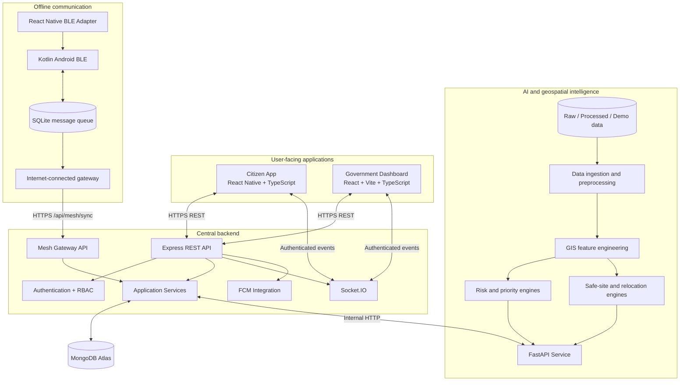
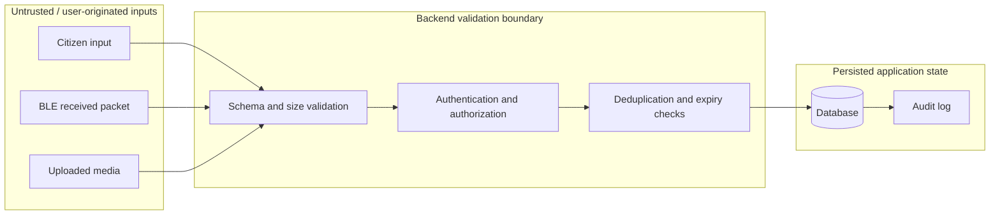
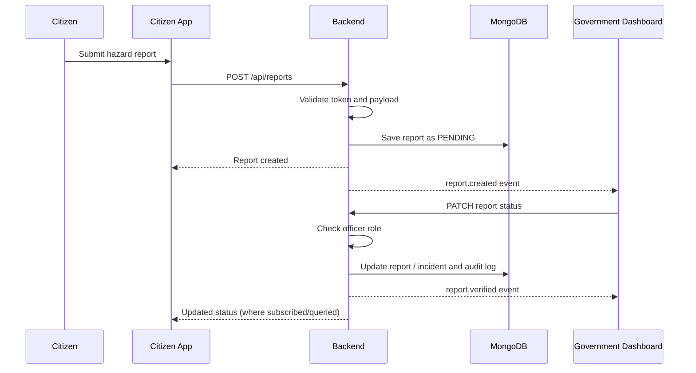
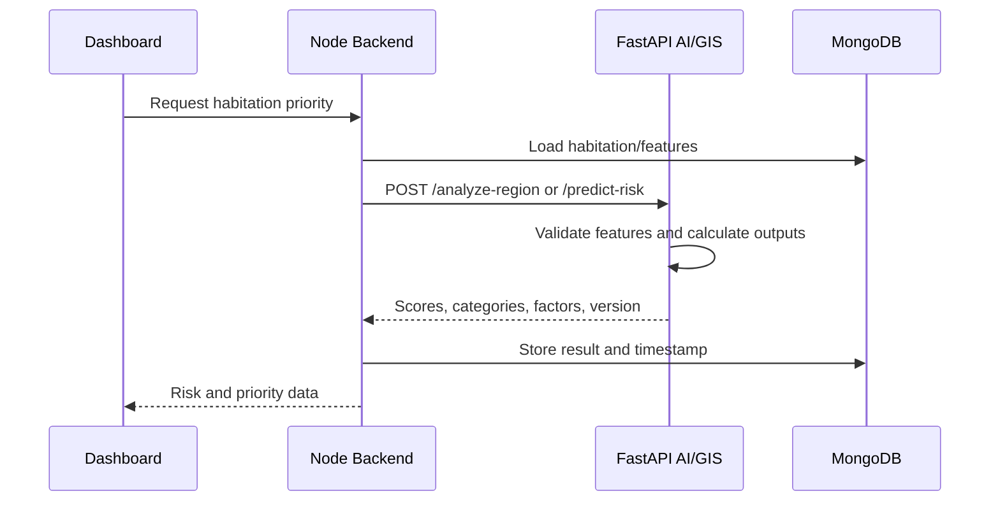
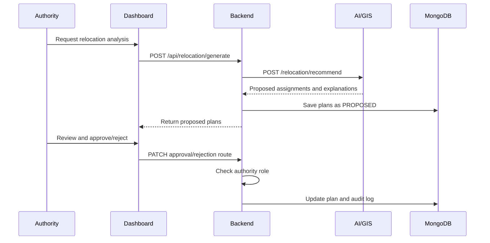
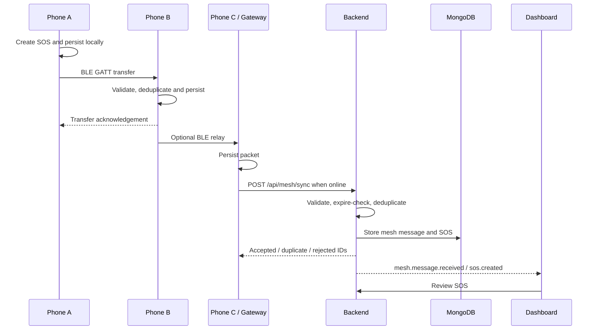

# RESQ-ZONE — System Architecture

## 1. Architecture goals

The architecture is designed around five goals:

1. **Modularity:** each major capability has a clear owner and interface.
2. **Central coordination:** the Node.js backend is the operational source of truth.
3. **Explainability:** risk and relocation outputs expose factors, timestamps and versions.
4. **Resilience:** the citizen app can queue emergency messages locally and use localized BLE relaying.
5. **Human authority:** verification, alert publication and relocation approval remain controlled by authorized personnel.

The architecture is an MVP design. It should not be described as a certified or production-ready emergency-management system.

## 2. High-level architecture

## 3. Component responsibilities

### 3.1 Citizen app

Responsibilities:
- Citizen authentication and profile.
- Location and map presentation.
- Hazard report and SOS forms.
- Display risk information and safe sites.
- Display official alerts.
- Local status and pending-message interface.
- Invoke the BLE adapter for offline message operations.

It must not:
- Connect directly to MongoDB.
- Call the AI service directly.
- decide that a citizen must evacuate.
- Claim a BLE message has reached authorities without backend acknowledgement.

### 3.2 Government dashboard

Responsibilities:
- Authority authentication and role-based UI.
- Incident/report review.
- Operational map and lists.
- Habitation priority and risk visualization.
- Safe-site and capacity overview.
- Relocation proposal review.
- Alert creation and publication.
- Real-time updates from authorized backend events.

It must not:
- Bypass backend authorization.
- Publish alerts using client-only logic.
- Treat citizen-submitted data as verified automatically.

### 3.3 Node.js backend

The backend coordinates all application workflows.

Responsibilities:
- Authentication and RBAC.
- Input validation and API responses.
- Persistence and data access.
- Citizen reports, incidents and SOS lifecycle.
- Hazard, habitation and safe-site APIs.
- Calls to FastAPI AI/GIS service.
- Relocation proposal storage and approval workflow.
- Alert lifecycle and audit logs.
- Socket.IO events and push notification integration.
- BLE gateway ingestion and deduplication.

### 3.4 MongoDB Atlas

Stores operational application data:
- Users.
- Citizen reports and incidents.
- SOS messages.
- Habitations and hazard zones.
- Safe sites.
- Relocation plans.
- Alerts and acknowledgements.
- Mesh messages and audit logs.

Geospatial fields should use GeoJSON and appropriate `2dsphere` indexes.

### 3.5 FastAPI AI/GIS service

Responsibilities:
- Preprocessed geospatial features.
- Risk scoring and explainability.
- Habitation priority calculations.
- Safe-site suitability and capacity checks.
- Relocation recommendations.

The service does not manage users, passwords, authority roles, alerts or citizen communications.

### 3.6 Android BLE module

Responsibilities:
- Device capability and permission handling.
- BLE discovery and GATT transfer.
- Packet validation.
- Persistent local message storage.
- Deduplication, TTL and hop-limit rules.
- Best-effort store-and-forward.
- Gateway synchronization.

## 4. Trust boundaries

Citizen and BLE data must be treated as unverified input. Backend validation and authorized review are required before it becomes verified operational information.

## 5. Main workflows

### 5.1 Hazard report verification

### 5.2 Risk assessment

### 5.3 Relocation proposal

### 5.4 Offline SOS and gateway synchronization

A BLE transfer acknowledgement means the receiving device accepted the packet. It does not mean that the backend or emergency authority has received it.

## 6. Data ownership and source of truth

| Data | Primary owner | Persistence |
|---|---|---|
| User accounts and roles | Backend | MongoDB |
| Citizen reports | Backend | MongoDB |
| Verified incidents | Backend | MongoDB |
| SOS records | Backend | MongoDB |
| Local unsynchronized SOS packet | BLE module | Device SQLite |
| Habitation base data | AI/GIS data preparation + backend seed/import | Files and MongoDB |
| Risk calculation | AI/GIS | Result stored by backend |
| Safe-site suitability | AI/GIS | Result/plan stored by backend |
| Relocation approval | Backend authority workflow | MongoDB |
| Official alerts | Backend | MongoDB |
| BLE protocol state | BLE module | Device SQLite |
| Mesh synchronization result | Backend | MongoDB |

## 7. Key design decisions

- Backend is the only client-facing application API.
- AI/GIS is an internal service called by the backend.
- GeoJSON uses `[longitude, latitude]`.
- Risk scoring is explainable and versioned.
- Relocation outputs are proposals, not automatic actions.
- BLE uses localized store-and-forward, not a claim of unlimited connectivity.
- Every important state transition should have a timestamp.
- Shared IDs and schemas must be agreed before parallel development.
- Mock services must be visibly identified as mocks.

## 8. Scalability path

For the MVP, a modular monolith backend plus a separate AI/GIS service is sufficient. Avoid premature microservices.

Future scale options, only when justified:
- Background job queue for large GIS processing.
- Object storage for media and large geospatial files.
- Dedicated geospatial database or optimized spatial storage.
- Event broker for high-volume event delivery.
- Caching for frequently accessed map layers.
- Regional data partitioning.
- Observability, metrics and alerting.

These are future options, not assumed current implementations.
