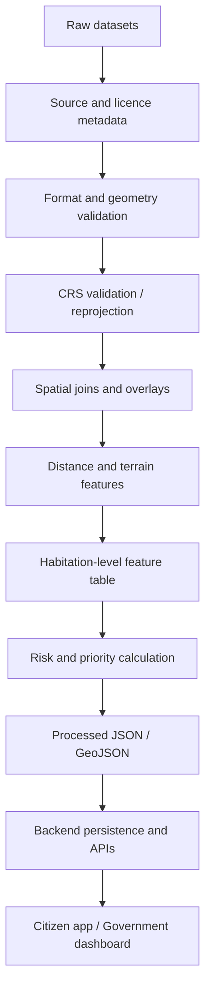
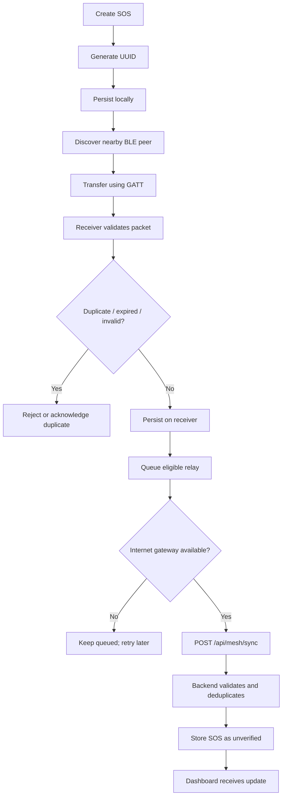

# RESQ-ZONE — Data Flow and Sequence Reference

## 1. Data categories

| Category | Examples | Ingestion / creation |
|---|---|---|
| Environmental | Rainfall, weather warnings | Official data source or clearly labelled demo input |
| Geospatial | DEM, water bodies, roads, hazard layers | GIS datasets and preprocessing |
| Population / habitation | Habitation boundaries, population aggregates | Open/official datasets or documented demo records |
| Infrastructure | Hospitals, shelters, roads, utilities | Open/official data or authority-provided data |
| Citizen-generated | Hazard reports, SOS | Citizen app or BLE gateway |
| Analytical | Risk score, priority, suitability | AI/GIS service |
| Operational | Verification, relocation approval, alerts | Authorized backend workflows |
| Offline packets | Queued SOS and relay metadata | Android BLE module |

## 2. Geospatial processing flow

Use projected coordinate systems for distance calculations. Keep original source data and processed outputs separate. Missing values must remain identifiable.

## 3. Citizen report flow

1. Citizen enters hazard type and description.
2. App obtains location with user permission.
3. App sends a request to `POST /api/reports`.
4. Backend validates authentication and request fields.
5. Backend stores report as `PENDING`.
6. Dashboard receives an event or fetches the new report.
7. Authorized officer reviews it.
8. Backend records verification/rejection and audit metadata.
9. A verified report may create or update an incident record.

## 4. Risk-analysis flow

1. Backend obtains habitation and feature data.
2. Backend calls the AI/GIS service.
3. AI/GIS validates feature ranges and missingness.
4. Risk engine calculates score and category.
5. Priority engine calculates a review order.
6. AI/GIS returns factors, version and timestamp.
7. Backend persists the result.
8. Dashboard renders score, category, explanation and freshness.

## 5. Safe-site and relocation flow

1. Load candidate safe sites and habitation needs.
2. Calculate remaining capacity.
3. Apply hard safety exclusions.
4. Evaluate services and accessibility.
5. Rank feasible sites.
6. Assign habitations within capacity constraints.
7. Return proposals and alternatives with explanations.
8. Backend stores each proposal as `PROPOSED`.
9. Authorized authority approves or rejects.
10. Backend records actor and timestamp.

## 6. BLE message flow

## 7. Alert flow

1. Authorized user drafts an alert.
2. Backend validates role, content, target and expiry.
3. Authorized user publishes.
4. Backend records publication and audit log.
5. Backend emits Socket.IO event and attempts push notification.
6. Client receives the alert when connectivity and platform delivery permit.
7. Acknowledgement is recorded independently.

Do not infer device receipt from publication or provider submission.

## 8. Data freshness

Every external or derived dataset should carry as much of the following as available:
- Source name.
- Source timestamp.
- Retrieval timestamp.
- Geographic coverage.
- CRS.
- Processing timestamp.
- Model/rule version.
- Validity or expiry.
- Simulated/observed/derived marker.

A stale analysis must be identified as stale, not presented as a live assessment.
