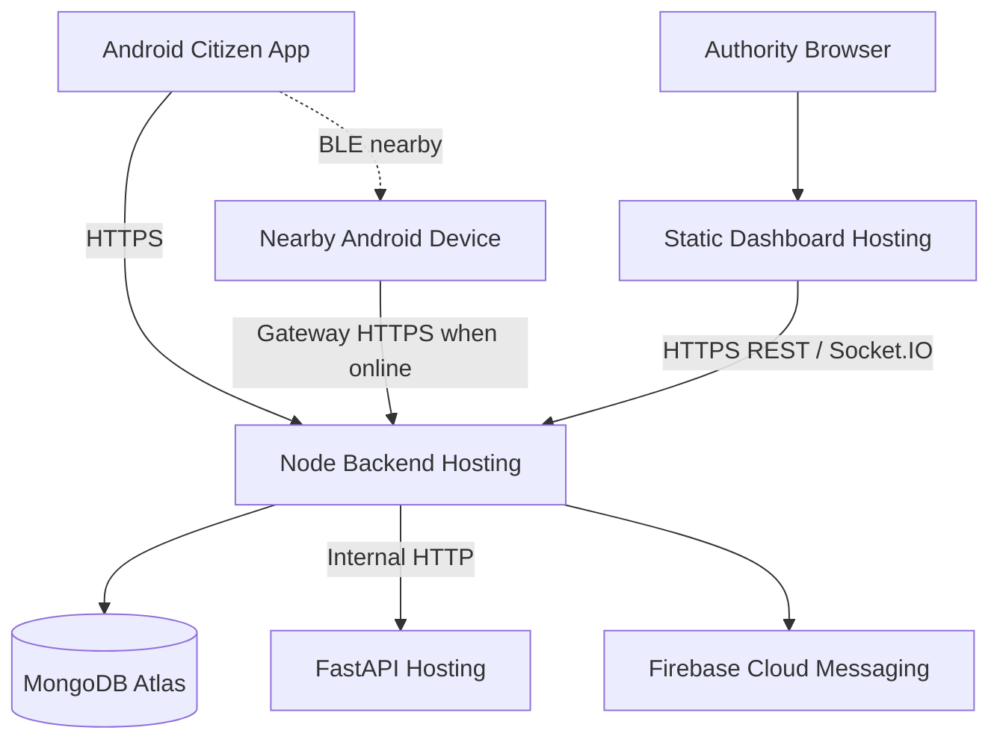

# RESQ-ZONE — Deployment Architecture

## 1. MVP deployment view

The system is composed of independently runnable applications/services:

| Component | Development runtime | Deployment consideration |
|---|---|---|
| Citizen app | Android device/emulator | Android build and device permissions |
| Government dashboard | Vite dev server | Static web hosting |
| Node backend | Express server | Node-compatible hosting |
| Database | MongoDB Atlas | Managed database with network access controls |
| AI/GIS | FastAPI + Uvicorn | Python-compatible hosting |
| BLE | Android native application/module | Physical device testing required |
| Push notifications | Firebase project | Credentials and platform configuration |

## 2. Logical deployment

## 3. Configuration principles

- Separate development, testing and production configuration.
- Use environment variables for secrets and URLs.
- Never commit service-account keys, private keys or database credentials.
- Restrict database network access.
- Configure CORS to known frontend origins.
- Use HTTPS for deployed APIs and gateway synchronization.
- Configure health endpoints for backend and AI/GIS.
- Store uploaded media in a controlled storage service if/when implemented; do not assume local temporary uploads are durable.

## 4. Service health

Suggested checks:
- Backend: `GET /health` (add if not yet implemented).
- AI/GIS: `GET /health`.
- Database: backend connection status.
- Mobile: local BLE capability and permission status.
- Gateway: internet reachability and last successful sync.

## 5. Deployment caveats

- BLE cannot be demonstrated by a normal web browser; physical Android devices are required.
- Android background execution is subject to OS restrictions.
- Socket.IO hosting must support the chosen transport and connection behavior.
- GIS dependencies such as GDAL/Rasterio may require compatible system libraries.
- A deployed AI service must be reachable from the backend, not exposed as a public client API unless explicitly secured.
- This deployment design is a target topology; only services actually deployed should be described as deployed.
