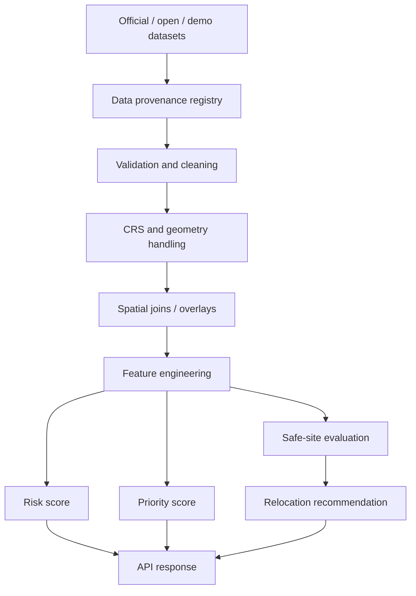

# RESQ-ZONE — AI and GIS Technical Design

## 1. Purpose

The AI/GIS module converts environmental, geographic, habitation and infrastructure information into explainable decision-support outputs.

It provides:
1. Habitation risk assessment.
2. Habitation prioritization.
3. Safe-site suitability evaluation.
4. Capacity-aware relocation proposals.

## 2. Processing pipeline



## 3. Input feature schema

Initial habitation features:

```json
{
  "hazardExposure": 0.0,
  "rainfallTrigger": 0.0,
  "populationExposure": 0.0,
  "vulnerability": 0.0,
  "evacuationDifficulty": 0.0,
  "infrastructureGap": 0.0
}
```

Where applicable, features are normalized to `[0, 1]`. Each feature must have a documented derivation method. Missing data must be represented explicitly and handled consistently.

## 4. Baseline risk formula

```text
riskScore = 100 × (
  0.30 × hazardExposure +
  0.20 × rainfallTrigger +
  0.15 × populationExposure +
  0.15 × vulnerability +
  0.10 × evacuationDifficulty +
  0.10 × infrastructureGap
)
```

Prototype categories:
- 0–19 `SAFE`
- 20–39 `LOW`
- 40–59 `MODERATE`
- 60–79 `HIGH`
- 80–100 `CRITICAL`

These weights and bands are illustrative MVP assumptions. They require domain validation before operational use.

## 5. Explainability

Return:
- Score and category.
- Input values.
- Weighted contributions.
- Main contributing factors.
- Data source and freshness metadata.
- Model/rule version.
- Calculation timestamp.
- Missing-data warnings.

For the weighted formula, contributions are the weighted terms in the equation. They are not trained-model feature importance.

## 6. Habitation prioritization

A separate priority score may combine:
- Risk score.
- Exposed population.
- Vulnerability.
- Evacuation difficulty.

The engine must document weights and return a reason for each rank. A priority rank is a review aid, not an automatic evacuation instruction.

## 7. Safe-site suitability

For each candidate site:
1. Check whether it intersects a prohibited/critical hazard area.
2. Calculate remaining capacity.
3. Assess water, sanitation, medical and other services.
4. Assess road access and logistics.
5. Calculate suitability and provide reasons.
6. Exclude sites that fail hard safety constraints.

```text
remainingCapacity = totalCapacity - currentOccupancy
```

Validate that capacity values are non-negative and occupancy does not exceed total capacity unless the data model explicitly represents an over-capacity condition.

## 8. Relocation recommendation

The MVP algorithm:
1. Sort habitations by priority.
2. Filter unsafe sites.
3. Filter sites without sufficient remaining capacity.
4. Rank feasible sites by safety, capacity, services, accessibility and distance.
5. Assign without exceeding capacity.
6. Return alternatives and explanations.
7. Mark all outputs as proposals.

Authority approval is performed by the backend workflow, not by the AI engine.

## 9. Data quality requirements

For every dataset, document:
- Provider/source.
- Retrieval date.
- Source date.
- Licence/access restrictions.
- Geographic coverage.
- Coordinate reference system.
- Resolution/scale where relevant.
- Processing steps.
- Missing values and known limitations.
- Simulated/observed/derived status.

Use actual public data only when access and provenance can be verified. Do not invent an API endpoint or claim a dataset is live without evidence.

## 10. API surface

- `GET /health`
- `POST /predict-risk`
- `POST /analyze-region`
- `POST /safe-sites/evaluate`
- `POST /relocation/recommend`

Node backend calls these endpoints and persists the results. The AI/GIS service does not authenticate end users or send alerts.

## 11. Validation and tests

Test:
- Feature range validation.
- Score boundaries.
- Missing-data behavior.
- Geometry validity and CRS transformations.
- Hard safety exclusion.
- Capacity constraints.
- Relocation assignment totals.
- API schemas and error responses.
