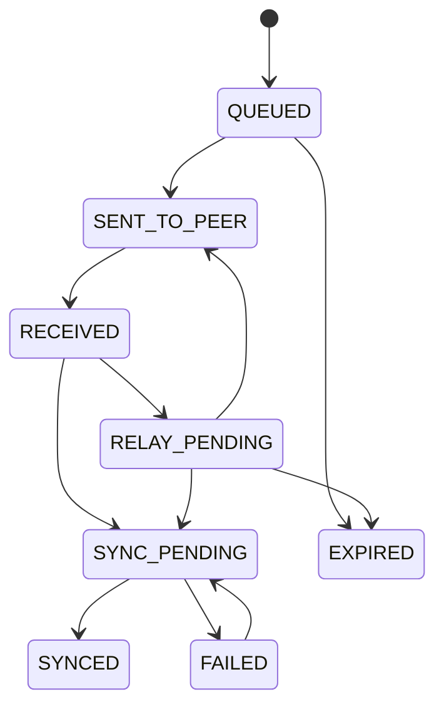

# RESQ-ZONE — BLE Offline Communication Protocol

## 1. Purpose and limitations

The BLE module provides a localized, best-effort store-and-forward path for emergency messages when internet or cellular service is unavailable.

It is:
- Short range.
- Dependent on device hardware, permissions and operating-system behavior.
- Best effort, not guaranteed delivery.
- Not a full implementation of the Bluetooth Mesh standard.
- Not a replacement for official emergency communication channels.

## 2. Message lifecycle



The exact local states may be refined during implementation, but the UI must not confuse peer receipt with server receipt.

## 3. Packet format

```json
{
  "protocolVersion": 1,
  "messageId": "UUID",
  "type": "SOS",
  "originDeviceId": "DEVICE-001",
  "createdAt": "ISO_DATE",
  "expiresAt": "ISO_DATE",
  "location": {
    "latitude": 21.1458,
    "longitude": 79.0882,
    "accuracyMeters": 15
  },
  "priority": "CRITICAL",
  "payload": {
    "peopleCount": 4,
    "helpRequired": "EVACUATION",
    "description": "Need assistance"
  },
  "hopCount": 0,
  "maxHops": 6
}
```

Do not put sensitive message content in BLE advertising packets. Use advertisements for discovery and exchange packet data over an established GATT connection.

## 4. GATT service

The implementation team must define and document:
- A custom service UUID.
- Message transfer characteristic.
- Acknowledgement characteristic.
- Device/protocol information characteristic.
- Optional notification/status characteristic.
- Read/write/notify properties.
- Connection lifecycle and timeout behavior.

UUIDs must be generated and recorded in the protocol documentation; do not use undocumented arbitrary values.

## 5. Transfer framing

BLE writes have payload-size constraints. Do not assume a JSON packet fits in one write.

If chunking is needed, define a frame with:
- Message ID.
- Transfer ID.
- Chunk index.
- Total chunks.
- Payload length.
- Optional integrity/checksum field.

Receiver must reject incomplete or malformed reassembly and avoid storing partial packets as valid SOS messages.

## 6. Validation rules

A receiving device should:
1. Validate protocol version.
2. Validate required fields and payload size.
3. Validate timestamps and expiry.
4. Check hop count against max hops.
5. Check the persistent seen-message ID store.
6. Persist a valid packet.
7. Acknowledge receipt.
8. Queue eligible packets for relay.

Do not relay expired packets or packets at/over the configured hop limit.

## 7. Deduplication and relay

- `messageId` is generated once by the origin device.
- Keep seen IDs persistently.
- A duplicate must not create a second SOS or queue record.
- Increment hop count when forwarding.
- Use retry/backoff to avoid connection loops.
- Avoid repeatedly forwarding to a peer already known to have the message, where that information is available.

## 8. Local persistence

Suggested fields:
- `messageId`
- `type`
- `packetJson`
- `status`
- `hopCount`
- `createdAt`
- `expiresAt`
- `lastAttemptAt`
- `gatewaySyncedAt`

The local queue must survive app restarts.

## 9. Gateway synchronization

Endpoint: `POST /api/mesh/sync`

Example envelope:

```json
{
  "gatewayDeviceId": "DEVICE-GATEWAY-01",
  "protocolVersion": 1,
  "syncedAt": "ISO_DATE",
  "messages": []
}
```

Backend response should identify:
- Accepted IDs.
- Duplicate IDs.
- Rejected IDs and reasons.

A failed upload must not cause a queued message to be deleted. Retry transient failures and mark messages synced only after a backend response confirms acceptance or duplicate recognition.

## 10. Security and privacy

- Use HTTPS for gateway sync.
- Authenticate gateway uploads using the backend-agreed method.
- Validate size, schema, timestamps and hop count.
- Avoid sensitive data in advertisements.
- Do not claim end-to-end encryption or verified device identity unless implemented and tested.
- Apply appropriate local data protection and retention.

## 11. Android constraints

Handle BLE permission changes, Bluetooth disabled, unsupported hardware, connection failures, timeouts, background restrictions and process termination.

Do not promise continuous background relaying when Android may suspend or terminate the application. The MVP demonstration should use a foreground workflow on physical Android phones.
