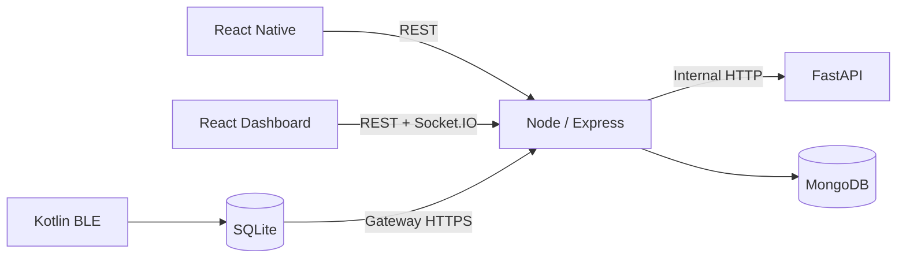

# RESQ-ZONE — Technology Stack and Tools

This document identifies the planned technologies, their responsibilities and integration boundaries. A technology listed here is part of the target design; update this document if implementation choices change.

## 1. Frontend

### Citizen mobile application

| Technology | Use |
|---|---|
| React Native | Cross-platform mobile UI framework; MVP targets Android |
| TypeScript | Typed application code |
| React Navigation | Screen navigation |
| Axios | Backend HTTP requests |
| React Native Maps | Map rendering |
| SQLite | Durable local message/cache storage where required |
| AsyncStorage | Lightweight local preferences/session metadata |
| Firebase Cloud Messaging | Online push notification integration, if configured |
| Native Android module | Bridge from React Native to Kotlin BLE functionality |

### Government dashboard

| Technology | Use |
|---|---|
| React | Component-based UI |
| Vite | Development server and build tooling |
| TypeScript | Typed UI and API models |
| Tailwind CSS | Styling |
| React Router | Web route navigation |
| Axios | Backend requests |
| Leaflet / React-Leaflet | Interactive maps |
| Socket.IO Client | Authenticated real-time events |

## 2. Backend

| Technology | Use |
|---|---|
| Node.js | JavaScript runtime |
| Express | HTTP routing and middleware |
| TypeScript | Backend type safety |
| MongoDB Atlas | Managed document database |
| Mongoose | Schema definitions, validation and indexes |
| JWT | Access-token authentication |
| bcrypt | Password hashing |
| Zod or Joi | Request validation; select one consistently |
| Socket.IO | Real-time event transport |
| Firebase Admin SDK | Server-side FCM integration |
| Multer | Multipart upload handling if media upload is implemented |

## 3. AI and GIS

| Technology | Use |
|---|---|
| Python | Data processing and service implementation |
| FastAPI | Internal AI/GIS HTTP service |
| Pydantic | Input and output validation |
| Pandas | Tabular data manipulation |
| NumPy | Numerical operations |
| GeoPandas | Vector geospatial analysis |
| Shapely | Geometry operations |
| Rasterio | Raster/DEM reading and processing where needed |
| GDAL | Geospatial format and coordinate operations where needed |
| scikit-learn | Optional future trained ML models |
| Joblib | Persisting trained models/pipelines if used |
| QGIS | Manual inspection and validation of spatial layers |
| Uvicorn | ASGI server |

## 4. Offline communication

| Technology | Use |
|---|---|
| Kotlin | Native Android BLE implementation |
| Android BLE APIs | Scanning, advertising and GATT |
| BLE GATT | Structured device-to-device data transfer |
| SQLite | Durable message queue and deduplication state |
| React Native native module | Expose BLE functions/events to the app |
| HTTPS | Gateway-to-backend synchronization |

## 5. Development and collaboration

| Tool | Use |
|---|---|
| Git | Version control |
| GitHub | Repository, branches and pull requests |
| Postman / curl | API testing |
| Android Studio | Android builds, emulator and device debugging |
| VS Code | General development |
| QGIS | GIS dataset inspection |
| MongoDB Atlas tools | Database inspection |
| Automated test framework | Unit and integration tests chosen per module |

## 6. Integration boundaries

Rules:
- Both frontends communicate with the backend, not MongoDB.
- The backend calls the AI/GIS service.
- BLE transfers locally between nearby devices.
- A gateway sends queued messages to the backend.
- Shared contracts define field names and status values.

## 7. Technology selection notes

- The MVP uses a modular architecture rather than many microservices.
- The AI/GIS service is separate because it uses a Python geospatial ecosystem.
- Android BLE is native because reliable BLE access requires platform APIs.
- MongoDB stores operational entities and GeoJSON fields; geospatial query/index behavior must be tested with the selected schemas.
- Do not add a new framework or infrastructure component without a concrete MVP need and team agreement.
